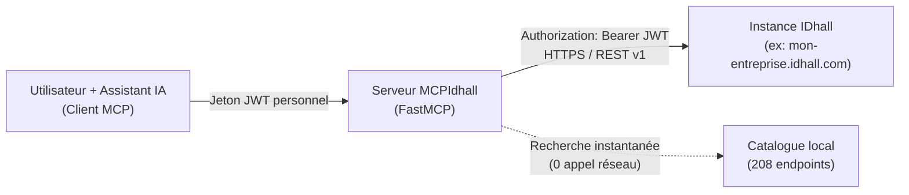
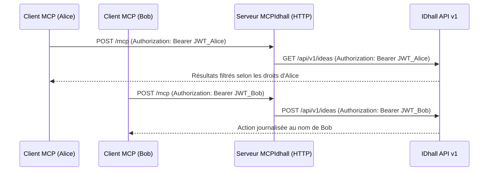

# Guide Utilisateur Complet — MCPIdhall

> [🇬🇧 **English version (USER_GUIDE.md)**](USER_GUIDE.md) | 🇫🇷 **Français**

> **Du débutant au professionnel** : tout ce qu'il faut pour installer, configurer, utiliser au quotidien et déployer en entreprise le serveur MCP **MCPIdhall** connecté à l'API REST d'**IDhall** (*Humanperf Software*).

---

## Sommaire

1. [Avant-propos : Comment fonctionne MCPIdhall ?](#1-avant-propos--comment-fonctionne-mcpidhall-)
2. [Niveau Débutant — Premiers pas en 10 minutes (Mode local `stdio`)](#2-niveau-débutant--premiers-pas-en-10-minutes-mode-local-stdio)
3. [Niveau Intermédiaire — Utilisation quotidienne (Lecture & Écriture)](#3-niveau-intermédiaire--utilisation-quotidienne-lecture--écriture)
4. [Niveau Avancé — Exploiter 100 % des 208 endpoints IDhall](#4-niveau-avancé--exploiter-100--des-208-endpoints-idhall)
5. [Niveau Professionnel — Déploiement multi-utilisateurs & Sécurité](#5-niveau-professionnel--déploiement-multi-utilisateurs--sécurité)
6. [Annexe — Référence des variables d'environnement & Dépannage (FAQ)](#6-annexe--référence-des-variables-denvironnement--dépannage-faq)

---

## 1. Avant-propos : Comment fonctionne MCPIdhall ?

**MCPIdhall** est un serveur **MCP** (*Model Context Protocol*) basé sur **FastMCP** qui permet à un assistant IA (Antigravity, Claude Desktop, Cursor, VS Code Copilot, etc.) d'interagir directement avec votre plateforme **IDhall** en lecture et en écriture.



### Principes clés de sécurité
* **Un jeton par utilisateur :** chaque utilisateur fournit son **propre jeton JWT IDhall**. Le serveur ne partage jamais de jeton entre utilisateurs.
* **Respect strict des droits IDhall (RBAC) :** toutes les actions effectuées via l'IA héritent exactement des permissions de votre profil IDhall. Si vous ne pouvez pas modifier ou supprimer une initiative dans l'interface web, l'IA ne le pourra pas non plus.
* **Résolution automatique de l'instance :** l'URL de votre environnement IDhall (ex. `https://mon-entreprise.idhall.com`) est lue directement dans le champ `iss` de votre jeton JWT.

---

## 2. Niveau Débutant — Premiers pas en 10 minutes (Mode local `stdio`)

Ce parcours est destiné à une utilisation individuelle sur votre poste de travail.

### Étape 1 : Générer votre jeton JWT dans IDhall

1. Connectez-vous à votre instance IDhall dans votre navigateur (ex. `https://mon-entreprise.idhall.com`).
2. Cliquez sur votre nom en haut à droite, puis ouvrez :
   **`Mon compte > Connexion et sécurité > Jetons d'authentification pour l'API REST`**
   *(lien direct typique : `https://<votre-instance>.idhall.com/account-settings.php?tab=security#api-tokens-section`)*.
3. Cliquez sur **Générer un nouveau jeton** :
   * Donnez-lui un nom explicite (ex. `MCPIdhall - Poste de travail`).
   * Choisissez une **date d'expiration** raisonnable (ex. 3 à 12 mois).
   * *(Optionnel)* Ajoutez une **restriction par adresse IP** si vous travaillez depuis un réseau fixe.
4. **Copiez immédiatement le jeton** (une longue chaîne commençant par `eyJ...`).

> ⚠️ **Important :** IDhall n'affiche la valeur du jeton **qu'une seule fois**. Traitez-le comme un mot de passe : ne le publiez jamais dans un dépôt Git, un e-mail ou un chat public.

---

### Étape 2 : Installer les prérequis et le projet

Vous avez besoin de **Python ≥ 3.11** et du gestionnaire ultra-rapide **[`uv`](https://docs.astral.sh/uv/)**.

1. **Installer `uv`** (si ce n'est pas déjà fait) :
   * Linux / macOS :
     ```bash
     curl -LsSf https://astral.sh/uv/install.sh | sh
     ```
   * Windows (PowerShell) :
     ```powershell
     powershell -ExecutionPolicy ByPass -c "irm https://astral.sh/uv/install.ps1 | iex"
     ```

2. **Installer les dépendances de `MCPIdhall`** :
   ```bash
   cd /chemin/vers/MCPIdhall
   uv sync
   ```

3. **Vérifier que l'installation fonctionne** :
   ```bash
   uv run mcp-idhall --help
   ```

---

### Étape 3 : Connecter `MCPIdhall` à votre client MCP

Ajoutez la configuration suivante dans le fichier de configuration MCP de votre client IA (ex. `mcp_config.json` dans Antigravity, `claude_desktop_config.json` dans Claude Desktop, `.cursor/mcp.json` dans Cursor) :

```json
{
  "mcpServers": {
    "idhall": {
      "command": "uv",
      "args": [
        "--directory",
        "/chemin/vers/MCPIdhall",
        "run",
        "mcp-idhall"
      ],
      "env": {
        "IDHALL_API_TOKEN": "<votre_jeton_jwt_idhall>"
      }
    }
  }
}
```

> **Astuce :** Remplacez `/chemin/vers/MCPIdhall` par le chemin absolu du dossier sur votre machine, et `<votre_jeton_jwt_idhall>` par votre jeton JWT personnel. Redémarrez ensuite votre client MCP.

---

### Étape 4 : Vos 3 premiers tests (en lecture seule)

Une fois le serveur connecté, essayez ces 3 demandes dans votre assistant IA :

1. **Vérifier votre identité :**
   > *« Qui suis-je dans IDhall ? Affiche mon nom, mon e-mail et la version de l'application. »*
   *(Déclenche `idhall_whoami` et `idhall_about`.)*

2. **Lister vos axes et initiatives :**
   > *« Liste les axes disponibles dans IDhall, puis affiche les 5 dernières initiatives avec leur titre et leur axe. »*
   *(Déclenche `idhall_list_reference_items` et `idhall_list_ideas`.)*

3. **Compter les initiatives :**
   > *« Combien y a-t-il d'initiatives dans l'axe Amélioration continue ? »*
   *(Déclenche `idhall_count_ideas`.)*

---

## 3. Niveau Intermédiaire — Utilisation quotidienne (Lecture & Écriture)

### Comprendre le fonctionnement de la projection (`props`)

Par défaut, l'API IDhall ne renvoie que les champs minimaux d'un objet (`id` et `title`) pour rester rapide. Pour obtenir des détails (description, auteur, étape, dates, gains…), l'assistant passe le paramètre `props`.

**Exemples de prompts efficaces :**
* *« Donne-moi les détails complets de l'initiative #870 (description, contexte, axe, étape en cours et responsables). »*
* *« Liste les 10 initiatives de l'axe 27 en incluant le nombre total. »*

---

### Créer et modifier des initiatives en toute sécurité

`MCPIdhall` est actif en **lecture et écriture**. Quelques bonnes pratiques :
* **Préférez les brouillons** pour les créations exploratoires :
  > *« Crée une initiative en brouillon dans l'axe 27 intitulée "Optimisation reporting mensuel" avec cette description : … »*
  *(Utilise `idhall_create_idea_draft`, qui n'envoie pas encore l'initiative dans le workflow de validation.)*
* **Publiez quand vous êtes prêt :**
  > *« Publie le brouillon d'initiative #912. »* *(Utilise `idhall_publish_idea_draft`.)*
* **Modification ciblée :**
  > *« Mets à jour le contexte de l'initiative #912 avec : … »* *(Utilise `idhall_update_idea`, en `PATCH` partiel uniquement sur les champs cités.)*
* **Suppression :** demandez toujours une confirmation explicite avant d'exécuter `idhall_delete_idea`.

---

### Piloter un plan d'action

* **Consulter les tâches :**
  > *« Affiche toutes les tâches du plan d'action de l'initiative #870 avec leurs responsables et leur avancement. »*
* **Ajouter une tâche :**
  > *« Ajoute une tâche "Rédiger le cahier des charges" au plan d'action de l'initiative #870, assignée à l'utilisateur #53. »*
* **Mettre à jour l'avancement :**
  > *« Passe l'avancement de la tâche #12 de l'initiative #870 à 60 % avec un niveau de confiance positif et le commentaire "Maquette validée". »*

---

### Collaborer (Contributions, Mémo, Tags) & Workflow

* **Ajouter une contribution :**
  > *« Ajoute une contribution sur l'initiative #870 : "Point validé en comité technique ce matin." »*
* **Gérer les tags :**
  > *« Ajoute les tags `IA` et `Prioritaire` à l'initiative #870. »*
* **Mettre à jour le mémo :**
  > *« Enregistre ce mémo sur l'initiative #870 : "Relancer le fournisseur mardi." »*
* **Faire avancer le workflow (`idhall_transition_idea_stage`) :**
  > *« Quelle est l'étape actuelle de l'initiative #870 ? »*
  > *« Mets l'initiative #870 en attente jusqu'au 2026-12-15 avec le commentaire "En attente de chiffrage". »*

Transitions de workflow supportées :
`standby`, `change-approver`, `request-details`, `request-expertise`, `approve--request-implementation-schedule`, `approve--launch-implementation`, `approve--end-implementation`, `reject`, `end-implementation`, `close`, `cancel`.

---

## 4. Niveau Avancé — Exploiter 100 % des 208 endpoints IDhall

`MCPIdhall` expose **33 outils dédiés** couvrant les usages courants, **plus un mécanisme universel** permettant d'accéder à l'intégralité des **208 endpoints** de l'API IDhall v1 sans surcharger le contexte de l'IA.

### Le workflow d'introspection en 3 étapes

Pour tout besoin spécialisé (audits / vérifications d'efficacité, contacts de parties prenantes, critères d'analyse d'opportunité, gestion des risques, modèles de plan d'action, demandes d'inscription…), l'IA enchaîne :

1. **`idhall_search_endpoints`** *(local, instantané, 0 requête réseau)* — trouve l'endpoint correspondant.
2. **`idhall_get_endpoint_spec`** *(local, instantané)* — récupère la liste exacte des paramètres, filtres, champs requis et classes typées.
3. **`idhall_api_request`** — exécute la requête `GET`, `POST`, `PUT`, `PATCH` ou `DELETE` sur `/api/v1/...`.

**Exemple de prompt :**
> *« Cherche dans l'API IDhall comment ajouter un contact à une partie prenante, vérifie les champs requis, puis ajoute Jean Dupont (jean.dupont@exemple.fr) à la partie prenante #4. »*

---

### Documentation locale & mise à jour après une montée de version IDhall

Le projet inclut trois fichiers de référence dans `docs/` :
* `docs/IDHALL_API_SYNTHESE.md` — Synthèse lisible en Markdown des 208 endpoints et 125 modèles.
* `docs/openapi.json` — Spécification **OpenAPI 3.1.0** (importable dans Postman, Bruno, Insomnia, Swagger UI).
* `docs/idhall_api_reference.json` — Export JSON brut complet utilisé par le catalogue local.

Si votre instance IDhall est mise à jour vers une nouvelle version (ex. `5.1`), régénérez facilement toute la documentation locale :

```bash
python3 scripts/fetch_idhall_reference.py
python3 scripts/build_docs_and_openapi.py
```

---

## 5. Niveau Professionnel — Déploiement multi-utilisateurs & Sécurité

Pour partager **un seul serveur MCPIdhall** au sein d'une équipe ou d'une entreprise sans jamais partager de jeton JWT, déployez-le en mode **`streamable-http`**.

### Architecture multi-utilisateurs



### Déploiement Docker (portable sur toute infrastructure & Nginx Proxy Manager)

Le dépôt inclut un [`Dockerfile`](../Dockerfile) multi-stage durci (utilisateur non-root `mcpuser`, système de fichiers en lecture seule, `HEALTHCHECK` intégré sur `/health`), un [`docker-compose.yml`](../docker-compose.yml) portable, un [`.env.docker.example`](../.env.docker.example) et un workflow GitHub Actions [`.github/workflows/docker-publish.yml`](../.github/workflows/docker-publish.yml) publiant automatiquement une image multi-arch (`amd64`/`arm64`) sur **GHCR**.

1. **Build et démarrage local (ou sur votre serveur) :**
   ```bash
   cp .env.docker.example .env.docker
   docker compose --env-file .env.docker up -d --build
   ```

2. **Vérifier la santé du conteneur :**
   ```bash
   curl -s http://127.0.0.1:8000/health
   # -> {"status":"ok","service":"mcp-idhall","version":"0.1.0"}
   ```

3. **Configuration derrière Nginx Proxy Manager (NPM) :**
   * **Details :**
     * *Domain Names* : `mcp-idhall.votre-domaine.fr`
     * *Scheme* : `http`
     * *Forward Hostname / IP* : IP du serveur (ou `mcp-idhall` si relié au même réseau Docker externe NPM)
     * *Forward Port* : `8000`
     * Cochez **Block Common Exploits** et **Websockets Support**.
   * **SSL :** activez votre certificat Let's Encrypt + **Force SSL** + **HTTP/2 Support**.
   * **Advanced (recommandé pour le streaming MCP `streamable-http` / `sse`) :**
     ```nginx
     proxy_buffering off;
     proxy_cache off;
     proxy_read_timeout 3600s;
     proxy_send_timeout 3600s;
     ```

4. **Déploiement depuis GHCR (autres infrastructures) :**
   * Une fois le dépôt poussé sur GitHub (`main` ou tag `v1.0.0`), l'image multi-arch est construite automatiquement sur `ghcr.io/<votre-user-ou-org>/mcp-idhall:latest`.
   * Sur n'importe quel serveur, un simple `docker run` suffit :
     ```bash
     docker run -d --name mcp-idhall --restart unless-stopped \
       -p 127.0.0.1:8000:8000 \
       -e IDHALL_ALLOWED_HOSTS="*" \
       --read-only --tmpfs /tmp --cap-drop ALL --security-opt no-new-privileges:true \
       ghcr.io/<votre-user-ou-org>/mcp-idhall:latest
     ```

### Lancer le serveur en mode HTTP (sans Docker)

```bash
uv run mcp-idhall --transport streamable-http --host 0.0.0.0 --port 8000
```

> 🔒 **Sécurité par défaut :** En mode `streamable-http` ou `sse`, le fichier `.env` n'est **pas** chargé automatiquement (sauf si vous ajoutez explicitement `--load-dotenv`). Chaque requête HTTP **doit** donc contenir son propre en-tête `Authorization: Bearer <jwt>`.

### Configurer un client MCP distant

Chaque utilisateur configure son client MCP avec l'URL du serveur et **son propre jeton JWT** :

```json
{
  "mcpServers": {
    "idhall": {
      "url": "https://mcp-idhall.votre-entreprise.fr/mcp",
      "headers": {
        "Authorization": "Bearer <votre_jeton_jwt_idhall>"
      }
    }
  }
}
```

### Bonnes pratiques de mise en production

1. **Reverse proxy HTTPS obligatoire :** Placez Nginx, Caddy ou Traefik devant `mcp-idhall` (écoute locale `127.0.0.1:8000`) avec TLS/HTTPS pour chiffrer les jetons JWT en transit.
2. **Protection anti-SSRF :** Par défaut, `MCPIdhall` n'accepte que les instances HTTPS en `*.idhall.com`. Si vous hébergez IDhall *on-premise* sur un domaine interne, définissez explicitement :
   ```bash
   export IDHALL_BASE_URL="https://idhall.mon-entreprise.intra"
   export IDHALL_ALLOWED_HOSTS="idhall.mon-entreprise.intra"
   ```
3. **Gestion du Rate Limiting (`HTTP 429`) :** Le client HTTP intégré applique automatiquement un backoff exponentiel (jusqu'à 4 tentatives, en respectant `Retry-After`) pour absorber les pics sans échouer brutalement.
4. **Exemple de service `systemd` (Linux) :**
   ```ini
   [Unit]
   Description=Serveur MCP IDhall (FastMCP)
   After=network.target

   [Service]
   Type=simple
   User=mcpidhall
   WorkingDirectory=/opt/MCPIdhall
   Environment=IDHALL_BASE_URL=https://mon-entreprise.idhall.com
   Environment=IDHALL_LANGUAGE=fr
   ExecStart=/opt/mcpidhall/.local/bin/uv run mcp-idhall --transport streamable-http --host 127.0.0.1 --port 8000
   Restart=on-failure
   RestartSec=5

   [Install]
   WantedBy=multi-user.target
   ```
5. **Tests automatisés (CI/CD) :**
   ```bash
   uv run pytest -v
   ```

---

## 6. Annexe — Référence des variables d'environnement & Dépannage (FAQ)

### Variables d'environnement

| Variable | Obligatoire | Défaut | Description |
| :--- | :---: | :--- | :--- |
| `IDHALL_API_TOKEN` | En mode `stdio` | — | Jeton JWT IDhall personnel (ignoré si `Authorization: Bearer` est fourni en HTTP) |
| `IDHALL_BASE_URL` | Non | Claim `iss` du JWT | URL HTTPS de votre instance IDhall (ex. `https://mon-entreprise.idhall.com`) |
| `IDHALL_ALLOWED_HOSTS` | Non | `*.idhall.com` | Liste d'hôtes autorisés séparés par des virgules (protection SSRF) |
| `IDHALL_LANGUAGE` | Non | `fr` | Valeur de l'en-tête `Accept-Language` (`fr`, `en`…) |
| `IDHALL_TIMEZONE` | Non | — | Valeur de l'en-tête `IDhall-Timezone` (ex. `Europe/Paris`) |
| `IDHALL_REFERENCE_JSON` | Non | `docs/idhall_api_reference.json` | Chemin alternatif vers l'export JSON du référentiel local |

### Dépannage rapide

| Symptôme / Erreur | Cause probable | Solution |
| :--- | :--- | :--- |
| `Aucun jeton JWT IDhall fourni` | En-tête `Authorization` manquant (HTTP) ou `IDHALL_API_TOKEN` absent (`stdio`) | Vérifiez votre config client MCP (`headers.Authorization` ou `env.IDHALL_API_TOKEN`). |
| `Votre jeton JWT IDhall est expiré` | Date `exp` du jeton dépassée | Générez un nouveau jeton dans `Mon compte > Connexion et sécurité`. |
| `HTTP 401` | Jeton révoqué, clé de signature régénérée ou IP non autorisée | Vérifiez les restrictions IP du jeton dans IDhall ou générez-en un nouveau. |
| `HTTP 403` | Permissions insuffisantes sur l'objet ou l'action | Normal : l'API applique vos droits IDhall. Demandez l'ajustement de profil à votre administrateur IDhall. |
| `HTTP 429 Too Many Requests` | Trop de requêtes simultanées vers Apache/IDhall | Le serveur réessaie automatiquement avec backoff. Évitez les boucles massives sur de grandes listes ; utilisez `page_size=100` et `filter`. |
| `Hôte IDhall non autorisé` | Domaine personnalisé hors `*.idhall.com` | Ajoutez votre domaine dans `IDHALL_ALLOWED_HOSTS` ou `IDHALL_BASE_URL`. |
| Seuls `id` et `title` apparaissent | Comportement normal d'IDhall sans paramètre `props` | Demandez explicitement les champs souhaités (l'IA passera `props=[...]`). |
