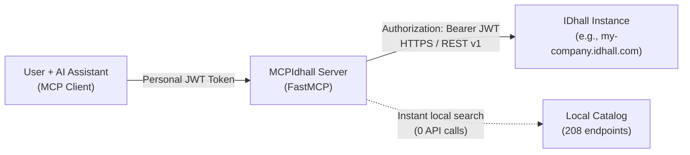
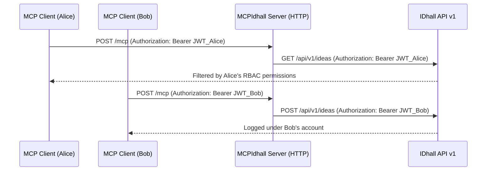

# Complete User Guide — MCPIdhall

> 🇬🇧 **English** | [🇫🇷 **Version française (GUIDE_UTILISATEUR.md)**](GUIDE_UTILISATEUR.md)

> **From Beginner to Professional:** everything you need to install, configure, use daily, and deploy in production the **MCPIdhall** MCP server for the **IDhall** REST API (*Humanperf Software*).

---

## Table of Contents

1. [Overview: How MCPIdhall Works](#1-overview-how-mcpidhall-works)
2. [Beginner Level — Get Started in 10 Minutes (Local `stdio` Mode)](#2-beginner-level--get-started-in-10-minutes-local-stdio-mode)
3. [Intermediate Level — Daily Read & Write Workflows](#3-intermediate-level--daily-read--write-workflows)
4. [Advanced Level — Unlock 100% of All 208 IDhall Endpoints](#4-advanced-level--unlock-100-of-all-208-idhall-endpoints)
5. [Professional Level — Multi-User Deployment & Security](#5-professional-level--multi-user-deployment--security)
6. [Appendix — Environment Variables & Troubleshooting FAQ](#6-appendix--environment-variables--troubleshooting-faq)

---

## 1. Overview: How MCPIdhall Works

**MCPIdhall** is a **Model Context Protocol (MCP)** server built with **FastMCP** that connects AI assistants (Antigravity, Claude Desktop, Cursor, VS Code Copilot, etc.) directly to your **IDhall** instance in read and write mode.



### Core Security Principles
* **Per-user JWT token:** Every user supplies their **own IDhall JWT token**. No token is ever shared between users.
* **Strict RBAC enforcement:** Every action performed via AI inherits the exact permissions of the user's IDhall access profile.
* **Automatic instance detection:** Your IDhall instance URL (e.g. `https://my-company.idhall.com`) is automatically inferred from the JWT `iss` claim.

---

## 2. Beginner Level — Get Started in 10 Minutes (Local `stdio` Mode)

### Step 1: Generate Your Personal JWT Token in IDhall

1. Log into your IDhall instance (e.g., `https://my-company.idhall.com`).
2. Click your name in the top-right corner and navigate to:
   **`My Account > Login & Security > REST API authentication tokens`**
   *(direct path: `https://<your-instance>.idhall.com/account-settings.php?tab=security#api-tokens-section`)*.
3. Click **Generate a new token**:
   * Give it a descriptive name (e.g., `MCPIdhall - Workstation`).
   * Set a reasonable **expiration date** (e.g., 3–12 months).
   * *(Optional)* Restrict usage to specific **IP addresses**.
4. **Copy the token immediately** — IDhall displays it **only once**.

> ⚠️ **Security notice:** Treat your JWT token like a password. Never commit it to Git or share it in chat/email.

---

### Step 2: Install Prerequisites & Project

You need **Python ≥ 3.11** and **[`uv`](https://docs.astral.sh/uv/)**.

1. **Install `uv`** (if not already installed):
   * Linux / macOS:
     ```bash
     curl -LsSf https://astral.sh/uv/install.sh | sh
     ```
   * Windows (PowerShell):
     ```powershell
     powershell -ExecutionPolicy ByPass -c "irm https://astral.sh/uv/install.ps1 | iex"
     ```
2. **Clone and install dependencies:**
   ```bash
   git clone https://github.com/smilebob/MCPIdhall.git
   cd MCPIdhall
   uv sync
   uv run mcp-idhall --help
   ```

---

### Step 3: Connect `MCPIdhall` to Your MCP Client

Add the following entry to your MCP client config (`~/.gemini/config/mcp_config.json` in Antigravity, `claude_desktop_config.json` in Claude Desktop, `.cursor/mcp.json` in Cursor):

```json
{
  "mcpServers": {
    "idhall": {
      "command": "uv",
      "args": [
        "--directory",
        "/path/to/MCPIdhall",
        "run",
        "mcp-idhall"
      ],
      "env": {
        "IDHALL_API_TOKEN": "<your_idhall_jwt_token>"
      }
    }
  }
}
```

Restart or refresh your MCP client.

---

### Step 4: Your First 3 Read-Only Tests

1. **Verify your identity:**
   > *"Who am I in IDhall? Show my name, email, and the IDhall version."*
   *(Calls `idhall_whoami` and `idhall_about`.)*
2. **List plans and initiatives:**
   > *"List the available plans in IDhall, then show the 5 latest initiatives with their title and plan."*
   *(Calls `idhall_list_reference_items` and `idhall_list_ideas`.)*
3. **Count initiatives:**
   > *"How many initiatives exist in the Continuous Improvement plan?"*
   *(Calls `idhall_count_ideas`.)*

---

## 3. Intermediate Level — Daily Read & Write Workflows

### Understanding Field Projection (`props`)

By default, IDhall `GET` endpoints return only minimal fields (`id`, `title`). To retrieve descriptions, authors, stages, or dates, the assistant passes `props=[...]`.

### Creating & Updating Initiatives Safely

* **Start with a draft (`idhall_create_idea_draft`):**
  > *"Create a draft initiative in plan #27 titled 'Monthly Reporting Automation' with this description: ..."*
* **Publish when ready (`idhall_publish_idea_draft`):**
  > *"Publish draft initiative #912."*
* **Partial updates (`idhall_update_idea`):**
  > *"Update the context of initiative #912 to: ..."*
* **Deletion (`idhall_delete_idea`):** always confirm explicitly before deleting.

### Managing Action Plans, Collaboration & Workflow

* **Action plan tasks:** list (`idhall_list_action_plan_tasks`), create (`idhall_create_action_plan_task`), update (`idhall_update_action_plan_task`), update progress (`idhall_update_task_progress`), or delete (`idhall_delete_action_plan_task`).
* **Collaboration:** add contributions (`idhall_add_idea_contribution`), set memos (`idhall_set_idea_memo`), manage tags (`idhall_manage_idea_tags`).
* **Workflow transitions (`idhall_transition_idea_stage`):**
  `standby`, `change-approver`, `request-details`, `request-expertise`, `approve--request-implementation-schedule`, `approve--launch-implementation`, `approve--end-implementation`, `reject`, `end-implementation`, `close`, `cancel`.

---

## 4. Advanced Level — Unlock 100% of All 208 IDhall Endpoints

For specialized endpoints (audits, stakeholder contacts, opportunity analysis criteria, risks, action-plan templates, registration requests…), the AI follows a 3-step workflow:

1. **`idhall_search_endpoints`** *(local, instant, 0 network calls)* — locates the exact endpoint.
2. **`idhall_get_endpoint_spec`** *(local, instant)* — inspects required parameters, filters, payload fields, and schemas.
3. **`idhall_api_request`** — executes `GET`, `POST`, `PUT`, `PATCH`, or `DELETE` against `/api/v1/...`.

### Refreshing Local Documentation After an IDhall Upgrade

```bash
python3 scripts/fetch_idhall_reference.py
python3 scripts/build_docs_and_openapi.py
```

---

## 5. Professional Level — Multi-User Deployment & Security

For team or enterprise deployments, run **one shared `MCPIdhall` server** in **`streamable-http`** mode so every user authenticates independently with `Authorization: Bearer <jwt>`.



### Docker, Portainer & Nginx Proxy Manager

See the dedicated beginner-to-pro deployment guide: **[`docs/DOCKER_PORTAINER_GUIDE.md`](DOCKER_PORTAINER_GUIDE.md)**.

### Running Directly Without Docker

```bash
uv run mcp-idhall --transport streamable-http --host 127.0.0.1 --port 8000
```

> 🔒 **Security by default:** In HTTP modes (`streamable-http` / `sse`), `.env` is **never** loaded automatically unless `--load-dotenv` is explicitly passed. Always place a TLS reverse proxy (Nginx Proxy Manager, Caddy, Traefik, Nginx) in front of the server.

---

## 6. Appendix — Environment Variables & Troubleshooting FAQ

### Environment Variables

| Variable | Required | Default | Description |
| :--- | :---: | :--- | :--- |
| `IDHALL_API_TOKEN` | In `stdio` mode | — | Personal IDhall JWT (ignored when HTTP `Authorization: Bearer` is present) |
| `IDHALL_BASE_URL` | No | JWT `iss` claim | HTTPS URL of your IDhall instance |
| `IDHALL_ALLOWED_HOSTS` | No | `*.idhall.com` (`*` in Docker) | Comma-separated allowed hostnames (SSRF protection) |
| `IDHALL_LANGUAGE` | No | `fr` | `Accept-Language` header (`en`, `fr`, …) |
| `IDHALL_TIMEZONE` | No | — | `IDhall-Timezone` header (e.g., `UTC`, `Europe/Paris`) |
| `IDHALL_REFERENCE_JSON` | No | `docs/idhall_api_reference.json` | Path to local API reference catalog |
| `MCP_TRANSPORT` | No | `stdio` (`streamable-http` in Docker) | `stdio`, `streamable-http`, or `sse` |
| `MCP_HOST` / `MCP_PORT` | No | `127.0.0.1` / `8000` | HTTP bind host and port |

### Troubleshooting

| Issue | Probable Cause | Fix |
| :--- | :--- | :--- |
| `Aucun jeton JWT IDhall fourni` | Missing `Authorization` header (HTTP) or `IDHALL_API_TOKEN` (`stdio`) | Check your MCP client config (`headers.Authorization` or `env.IDHALL_API_TOKEN`). |
| `Votre jeton JWT IDhall est expiré` | Token `exp` timestamp passed | Generate a new token in IDhall (`My Account > Login & Security`). |
| `HTTP 401` | Revoked token, rotated signing key, or IP restriction | Check IP restrictions in IDhall or generate a new token. |
| `HTTP 403` | Insufficient RBAC permissions | Expected: IDhall enforces your user profile permissions. |
| `HTTP 429 Too Many Requests` | Apache rate limit hit | Built-in exponential backoff retries automatically; use `page_size=100` and `filter`. |
| Only `id` and `title` returned | Default minimal projection in IDhall | Ask for specific fields so the AI passes `props=[...]`. |
